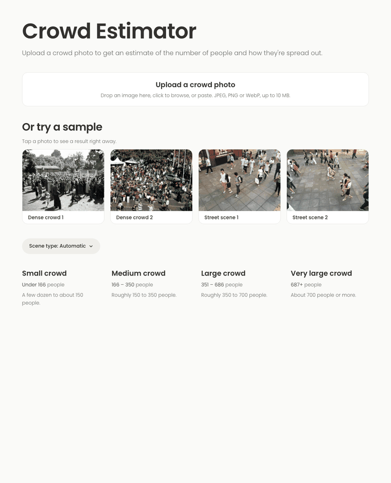
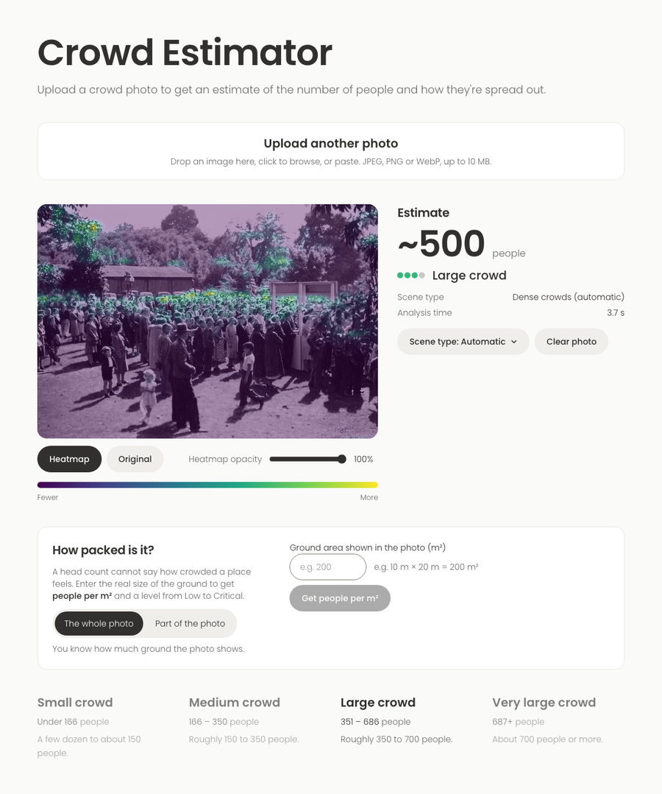
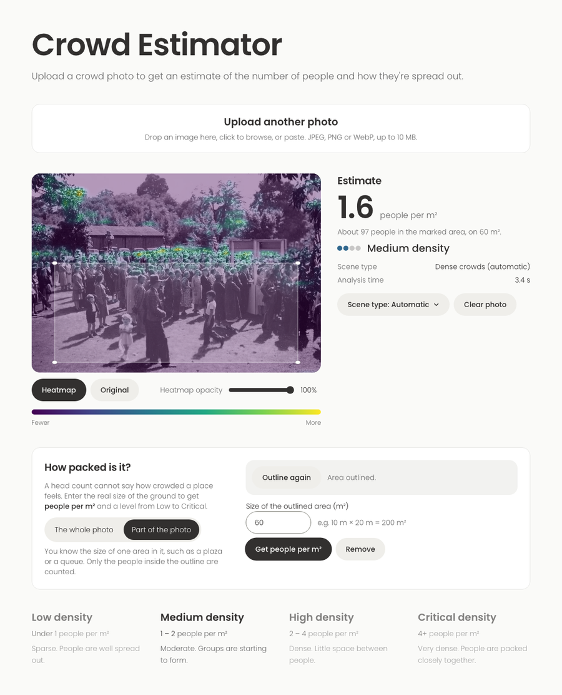
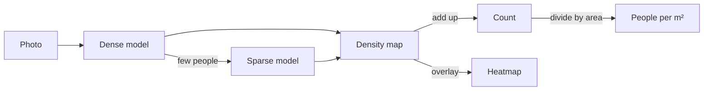

# Crowd Estimator

Upload a photo of a crowd and get a head count, a crowding level and a heatmap of where people stand.



## Features

- **Count and heatmap.** Brighter colours mean more people.
- **Labelled objects.** Boxes with class names (person, backpack, car...) drawn on the photo, in an
  **Objects** view that opens first. Needs a YOLO detector, see
  [docs/operations.md](docs/operations.md#labelled-objects).
- **People per m².** Give the ground area (the whole photo or an outlined region) and the app rates crowding
  from Low to Critical.
- **Automatic model choice.** One model handles packed crowds, another handles sparse scenes. The app picks,
  or you can force one.

| Count, heatmap and area form | Labelled objects and people per m² for an outlined area |
|---|---|
|  |  |

## Quick start

Put the two model files in `models/` (see [docs/operations.md](docs/operations.md#model-files)), then:

```shell
make docker-up          # Docker + Compose, then open http://localhost:8080
```

Or without Docker (Python 3.11, Node 22):

```shell
make setup                                        # environment and dependencies
ALT_MODEL_PATH=models/csrnet-partB.pth make api   # API on :8000
make web                                          # web app on :5173
```

`make help` lists all commands, including `make test` and `make lint`.

## API

```shell
curl -F file=@photo.jpg "http://localhost:8080/api/predict"
curl -F file=@photo.jpg "http://localhost:8080/api/predict?area_m2=200"
curl -F file=@photo.jpg "http://localhost:8080/api/predict?area_m2=60&region=[[0.1,0.5],[0.9,0.5],[0.9,0.95],[0.1,0.95]]"
```

| Parameter | Meaning |
|---|---|
| `area_m2` | Ground area in m². Adds `density` (people per m² and level) to the response |
| `region` | Outline `[[x, y], ...]` with x, y in 0–1 (fractions of the photo). Only people inside are counted, and `area_m2` is the size of this region |
| `label` | `true` burns the count, level and density as text onto the returned image |
| `detect` | `true` also returns labelled object boxes (`detections`, `detections_image`). Needs a YOLO detector, see [operations](docs/operations.md#labelled-objects) |
| `part` | `A` (dense) or `B` (sparse) forces a model. Omit to auto-select |

The response has `count`, `level`, `density` (if an area was given), a base64 PNG `heatmap` and the `model`
used. Errors return `{"detail": "...", "code": "..."}` with status 400, 413, 415, 422 or 503 (busy, with a
`Retry-After` header).

## Accuracy

Measured on ShanghaiTech test photos not used for training or tuning:

| Model | Photos | MAE (average miss) | RMSE |
|---|---|---|---|
| Dense crowds | 182 | 85.8 people | 122.8 |
| Sparse scenes | 316 | 11.7 people | 18.6 |

The CSRNet paper reports 68.2 and 10.6. Single photos can be well off, so treat counts as estimates. Details:
[docs/training.md](docs/training.md), [docs/results.md](docs/results.md).

## How it works



Each model is a [CSRNet](https://arxiv.org/abs/1802.10062) that turns a photo into a density map, where each
person is a blob summing to one. The count is the map's sum; the heatmap is the map drawn over the photo.
Built with PyTorch, FastAPI, React, Vite and Tailwind.

## Settings

Environment variables (full list in [api/.env.example](api/.env.example) and
[docs/operations.md](docs/operations.md)):

| Variable | Default | Purpose |
|---|---|---|
| `MODEL_PATH` | `models/csrnet-partA.pth` | Dense-crowd model |
| `ALT_MODEL_PATH` | none | Sparse-scene model; enables automatic choice |
| `MAX_UPLOAD_MB` | `10` | Largest accepted file |
| `CORS_ORIGINS` | `http://localhost:5173` | Allowed browser origins |
| `MAX_QUEUE` | `4` | Waiting requests before the API returns `503` |

## Repo layout

```text
api/        FastAPI service and tests
ml/         Model, training, evaluation, tests, Colab notebook
web/        React app
scripts/    Model file checks
models/     Model files (not committed) and checksums
data/       ShanghaiTech dataset (not committed)
docs/       Guides, results, screenshots
```

Docs: [training](docs/training.md) · [architecture](docs/architecture.md) · [operations](docs/operations.md) ·
[CONTRIBUTING.md](CONTRIBUTING.md)

## Credits

- Li, Zhang and Chen, [*CSRNet*](https://arxiv.org/abs/1802.10062), CVPR 2018
- Zhang et al., *Single-Image Crowd Counting via Multi-Column Convolutional Neural Network* (ShanghaiTech dataset), CVPR 2016

Sample photos and screenshots come from the ShanghaiTech test set, for demonstration only.
