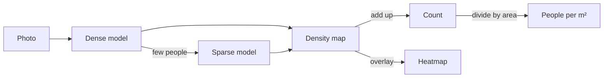

# Crowd Estimator

Upload a photo of a crowd and get an estimate of how many people are in it, how tightly they are packed,
and a heatmap of where they stand.


## What you get

- **A head count and a heatmap.** Brighter colours show where more people are.
- **People per m².** Tell the app how big the ground is (the whole photo, or an area you outline on it) and it
  rates the crowding from Low to Critical. A head count alone cannot say this: 500 people are roomy in a big
  space and tight in a small one.
- **The right model for the photo.** One model is trained for packed crowds and another for streets and open
  spaces. The app picks between them for you, and you can force one if you want.

| Count, heatmap and the area form | People per m² for an outlined area |
|---|---|
|  |  |

## Try it

You need the two model files in `models/` (see [docs/operations.md](docs/operations.md#model-files)).

**With Docker** (Docker with Compose):

```shell
make docker-up
```

Open <http://localhost:8080>.

**Without Docker** (Python 3.11 and Node 22):

```shell
make setup                                        # environment and dependencies
ALT_MODEL_PATH=models/csrnet-partB.pth make api   # API on :8000
make web                                          # web app on :5173
```

`make help` lists every command, including `make test` and `make lint`.

## Use the API

```shell
curl -F file=@photo.jpg "http://localhost:8080/api/predict"
curl -F file=@photo.jpg "http://localhost:8080/api/predict?area_m2=200"
curl -F file=@photo.jpg "http://localhost:8080/api/predict?area_m2=60&region=[[0.1,0.5],[0.9,0.5],[0.9,0.95],[0.1,0.95]]"
```

| Parameter | Meaning |
|---|---|
| `area_m2` | Ground area in m². Adds `density` to the answer: people per m² and its level |
| `region` | An outline `[[x, y], ...]` with x and y from 0 to 1 (fractions of the photo). Then `area_m2` is the size of that outlined area, and only people inside it are counted |
| `part` | `A` (dense crowds) or `B` (sparse scenes) forces one model. Leave it out to let the app choose |

The answer contains `count`, `level`, `density` (when you gave an area), a base64 PNG `heatmap` and the
`model` that was used. Problems come back as `{"detail": "...", "code": "..."}` with status 400, 413, 415,
422 or 503 (busy, with a `Retry-After` header).

## How accurate is it?

Measured on ShanghaiTech test photos that were never used for training or tuning:

| Model | Photos | Average miss (MAE) | RMSE |
|---|---|---|---|
| Dense crowds | 182 | 85.8 people | 122.8 |
| Sparse scenes | 316 | 11.7 people | 18.6 |

The CSRNet paper reports 68.2 and 10.6 for the same measure. Counting people is hard and single photos can be
well off, so treat the numbers as estimates. How the models were trained, what was tried and the worst
predictions are in [docs/training.md](docs/training.md) and [docs/results.md](docs/results.md).

## How it works



Each model is a [CSRNet](https://arxiv.org/abs/1802.10062) that turns a photo into a "density map": a
picture where every person is a small blob adding up to one. The count is the sum of the map, and the
heatmap is the map drawn over your photo. It is built with PyTorch, FastAPI, React, Vite and Tailwind.

## Settings

The API is configured with environment variables. The common ones:

| Variable | Default | What it does |
|---|---|---|
| `MODEL_PATH` | `models/csrnet-partA.pth` | The dense-crowd model. `ALT_MODEL_PATH` adds the sparse-scene model and turns on automatic choice |
| `MAX_UPLOAD_MB` | `10` | Largest file accepted |
| `CORS_ORIGINS` | `http://localhost:5173` | Browser origins allowed to call the API |
| `MAX_QUEUE` | `4` | Requests allowed to wait before the API answers `503` |

All of them are in [api/.env.example](api/.env.example) and explained in [docs/operations.md](docs/operations.md).

## What is in the repo

```text
api/        FastAPI service and its tests
ml/         Model, training, evaluation, tests and a Colab notebook
web/        React app
scripts/    Model file checks
models/     Model files (not committed) and their checksums
data/       ShanghaiTech dataset (not committed)
docs/       Guides, results and screenshots
```

- [docs/training.md](docs/training.md): the data, how the models were trained, results, how to repeat it
- [docs/architecture.md](docs/architecture.md): how a photo flows through training and the API
- [docs/operations.md](docs/operations.md): running, settings, privacy and automated checks
- [CONTRIBUTING.md](CONTRIBUTING.md): ground rules for changes

## Credits

- Li, Zhang and Chen, [*CSRNet: Dilated Convolutional Neural Networks for Understanding the Highly Congested Scenes*](https://arxiv.org/abs/1802.10062), CVPR 2018
- Zhang et al., *Single-Image Crowd Counting via Multi-Column Convolutional Neural Network* (the ShanghaiTech dataset), CVPR 2016

The sample photos and screenshots come from the ShanghaiTech test set and are used for demonstration only.
