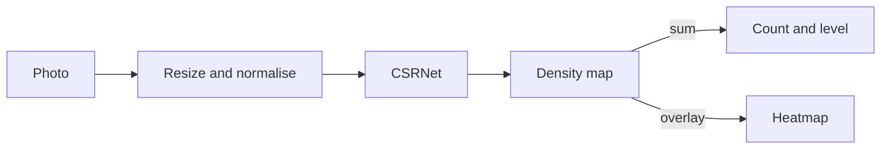

# Crowd Estimator

Upload a crowd photo and get an estimated head count, a density level, and a heatmap of where people gather.



## Features

- Head count, four density levels (Low to Critical), and a heatmap
- Two models: Part A for dense crowds, Part B for sparse scenes
- Upload checks on type, size and pixel count. Images stay in memory
- Returns `503` with `Retry-After` when the server is busy

## Tech stack

- **Model:** PyTorch, CSRNet, trained on ShanghaiTech
- **API:** FastAPI
- **Web:** React 19, Vite, Tailwind 4, TypeScript
- **Run:** Docker Compose

## Installation

### With Docker

You need Docker with Compose and the model checkpoints in `models/`.

```shell
make download-weights   # fetch and verify the checkpoints
make docker-up          # build and start the API and web app
```

Open <http://localhost:8080>.

### Locally

You need Python 3.11 and Node 22.

```shell
make setup   # virtual environment, dependencies, npm ci
make api     # API on :8000, docs at /docs
make web     # web app on :5173
make test    # ml, api and web tests
make lint    # ruff and eslint
```

`make help` lists every target. Training runs on Colab (`ml/notebooks/colab_train.ipynb`).

## Usage

Upload a photo in the web app, or call the API:

```shell
curl -F file=@photo.jpg "http://localhost:8080/api/predict?part=A"
```

The response has `count`, `level`, `local_concentration` and a base64 PNG `heatmap`.
Errors return `{"detail": "...", "code": "..."}` with status 400, 413, 415, 422 or 503.

## Configuration

Set these environment variables for the API. [api/.env.example](api/.env.example) has the full list.

| Variable | Default | Purpose |
|---|---|---|
| `MODEL_PATH` | `models/csrnet-partA.pth` | Checkpoint to serve. `ALT_MODEL_PATH` adds Part B. |
| `MAX_UPLOAD_MB` | `10` | Largest accepted upload |
| `CORS_ORIGINS` | `http://localhost:5173` | Allowed browser origins. Never use `*`. |
| `MAX_QUEUE` | `4` | Waiting requests before the API returns `503` |

## Project structure

```text
api/        FastAPI service and tests
ml/         CSRNet code, training, evaluation, tests, Colab notebook
web/        React app
scripts/    Checkpoint download
models/     Checkpoint manifest and weights
data/       ShanghaiTech dataset (not committed)
docs/       Architecture and build plan
```

See [docs/architecture.md](docs/architecture.md) for the data flow and tensor shapes.

## Acknowledgements

- Li, Zhang and Chen, [*CSRNet: Dilated Convolutional Neural Networks for Understanding the Highly Congested Scenes*](https://arxiv.org/abs/1802.10062), CVPR 2018
- Zhang et al., *Single-Image Crowd Counting via Multi-Column Convolutional Neural Network* (the ShanghaiTech dataset), CVPR 2016
