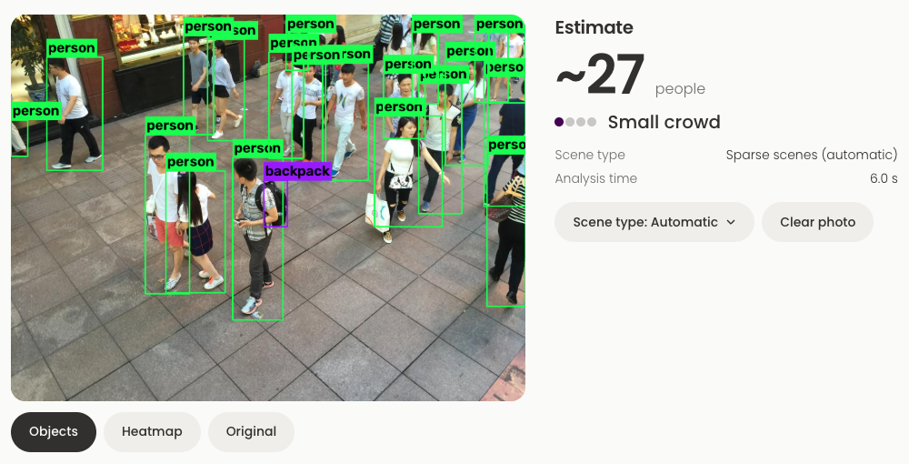

# Running and deploying

How to run Crowd Estimator on your machine, what you can configure, and what the automated checks do.

## Run it

You need the two model files in `models/`: `csrnet-partA.pth` (dense crowds) and `csrnet-partB.pth`
(sparse scenes). `models/weights.json` lists the SHA-256 checksum of each, and `make download-weights`
checks them (and downloads them once a release URL is added to that file).

**With Docker**

```shell
make docker-up     # builds and starts the API and the web app
make docker-down   # stops them
```

Open <http://localhost:8080>. The web app is served by nginx, which forwards `/api` to the API, so the
browser only talks to one address. The API container reads the models from `./models` (read-only) and
reports healthy at `/api/health` once both are loaded, which the web container waits for.

**Without Docker**

```shell
make setup   # Python environment, dependencies, npm packages
make api     # API on http://localhost:8000 (interactive docs at /docs)
make web     # web app on http://localhost:5173
```

Start the API with both models so photos are routed automatically:

```shell
ALT_MODEL_PATH=models/csrnet-partB.pth make api
```

## Settings

The API reads environment variables (or a local `.env`). `api/.env.example` lists them all with their
defaults.

| Variable | Default | What it does |
|---|---|---|
| `MODEL_PATH` | `models/csrnet-partA.pth` | The dense-crowd model |
| `ALT_MODEL_PATH` | not set | The sparse-scene model. Setting it turns on automatic model choice |
| `AUTO_ROUTE` | `True` | Choose the model per photo. `False` always uses `MODEL_PATH` unless a request says otherwise |
| `MAX_UPLOAD_MB` | `10` | Largest file the API accepts |
| `MAX_LONG_SIDE` | `1024` | Longer sides are shrunk to this before the model sees the photo |
| `MAX_IMAGE_PIXELS` | `60000000` | Rejects absurdly large images |
| `DEVICE` | `cpu` | `cpu`, `mps` or `cuda` |
| `TORCH_THREADS` | `1` | CPU threads per prediction |
| `MAX_CONCURRENT_INFERENCE` | `1` | Predictions running at once |
| `MAX_QUEUE` | `4` | Requests allowed to wait. Beyond that the API answers `503` with a `Retry-After` header |
| `CORS_ORIGINS` | `http://localhost:5173` | Browser origins allowed to call the API. Never `*` |
| `DETECTOR_PATH` | not set | YOLO weights for labelled boxes. Setting it enables `?detect=true` and the web **Objects** view |
| `DETECTOR_CONF` | `0.3` | Lowest confidence a box needs to be shown |
| `LOG_LEVEL` | `INFO` | Log detail |

A prediction takes about 3 to 4 seconds on one CPU thread for a 1024 × 768 photo.

## Labelled objects

Boxes with class names (person, backpack, car...) come from a separate pretrained YOLO detector, not from the
crowd models, so it is off until you set it up:

```shell
pip install ultralytics                       # or: pip install -e ml[detect]
DETECTOR_PATH=models/yolo11n.pt make api      # ultralytics downloads yolo11n.pt on first use
```

`?detect=true` then returns `detections` and a `detections_image`, and the web app opens on an **Objects** view.
Without a detector, `detect=true` returns a 422 (`detector_unavailable`). The detector only finds people it can
see clearly, so in a dense crowd it labels a small fraction of them. The head count stays the main number.



## Privacy

Uploaded photos are processed in memory and never written to disk. Logs record the request id, status and
timing, and never the image or its file name.

## Automated checks

GitHub Actions (`.github/workflows/ci.yml`) runs on pushes to `main` and on pull requests:

| Job | What it does |
|---|---|
| `ml + api` | Checks style with `ruff`, then runs the model tests and the API tests on CPU |
| `web` | Installs packages, lints, runs the tests and builds the app |
| `docker` | Builds both images (without publishing) to catch broken Dockerfiles |

The tests do not need the dataset or the real model files: the API tests use a randomly initialised
model that still goes through the normal loading checks. `make test` and `make lint` run the same
checks locally. `pre-commit install` adds a hook that formats code and blocks dataset or model files
from being committed.

## Model files

Model files are never committed or baked into the images. To publish a new model, copy `best.pth`
from its run folder into `models/`, update the checksum in `models/weights.json`, and attach the files to a
GitHub release.
