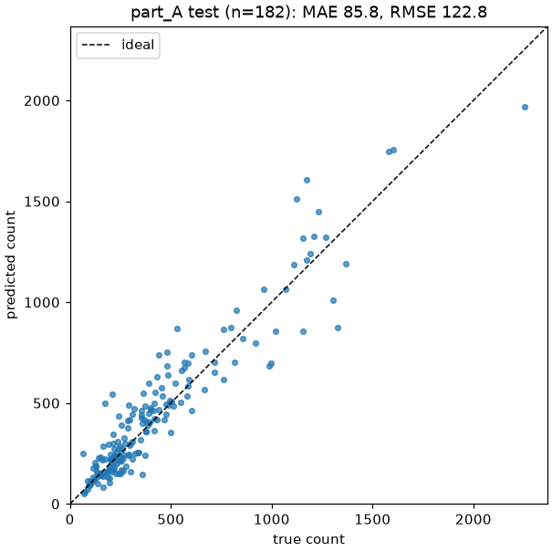
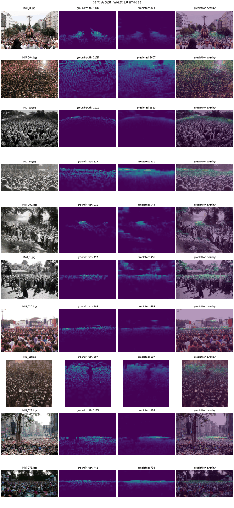
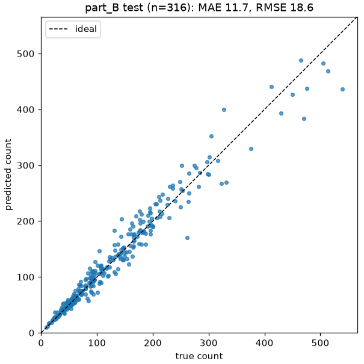
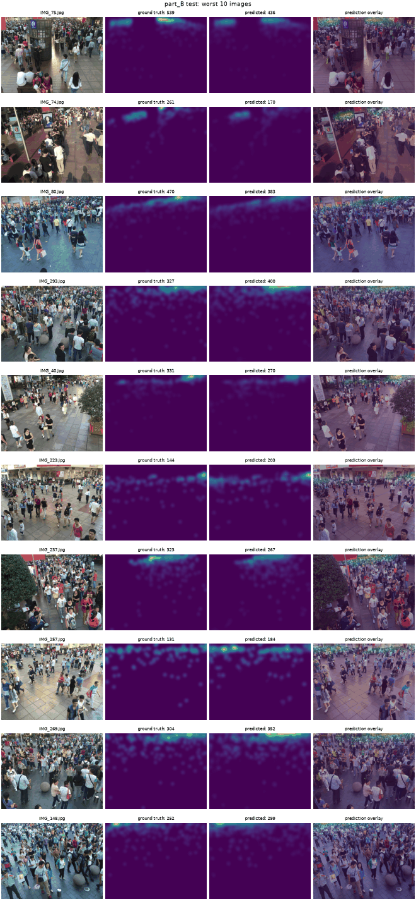

# Results

<!-- Generated by `python -m crowd.evaluate`. Do not edit by hand. -->

Test-set results of each part's selected checkpoint, read once. The acceptance bar is from `docs/training.md`; the published figures are CSRNet (Li et al., CVPR 2018), for reference only.

## Summary

| Part | Run | Images | MAE | RMSE | Bar (MAE / RMSE) | Verdict | Paper (MAE / RMSE) |
|---|---|---|---|---|---|---|---|
| A | [`part_A-soup`](runs/part_A-soup.json) | 182 | 85.8 | 122.8 | 85 / 135 | **missed** | 68.2 / 115.0 |
| B | [`part_B-full`](runs/part_B-full.json) | 316 | 11.7 | 18.6 | 16 / 24 | met | 10.6 / 16.0 |

## Part A

Checkpoint `best.pth` (epoch 54, `csrnet-partA-v1`), git `24aadcd`, dataset hash `4a68ff0b9179`, evaluated 2026-11-11T19:08:40.

### Error by ground-truth count

| Count | Images | MAE | RMSE | Bias (pred - true) |
|---|---|---|---|---|
| 0-99 | 7 | 37.5 | 70.5 | 22.4 |
| 100-499 | 129 | 68.3 | 95.7 | 26.5 |
| 500-999 | 28 | 107.7 | 136.4 | 3.9 |
| 1000+ | 18 | 196.0 | 236.9 | 10.0 |

### Diagnosis

- On average the model overcounts by 21.2 people per image (4.9% of the mean ground-truth count of 433).
- The 100-499 count bucket (129 images) accounts for 56% of the total absolute error.
- The 10 worst images account for 22% of it.

### Predicted vs true count

### The 10 worst images

| Image | True | Predicted | Error |
|---|---|---|---|
| IMG_8.jpg | 1326 | 873 | -453 |
| IMG_104.jpg | 1175 | 1607 | +432 |
| IMG_63.jpg | 1121 | 1513 | +392 |
| IMG_54.jpg | 529 | 871 | +342 |
| IMG_101.jpg | 211 | 543 | +332 |
| IMG_1.jpg | 172 | 501 | +329 |
| IMG_127.jpg | 986 | 685 | -301 |
| IMG_50.jpg | 997 | 697 | -300 |
| IMG_122.jpg | 1153 | 855 | -298 |
| IMG_175.jpg | 442 | 738 | +296 |

## Part B

Checkpoint `best.pth` (epoch 107, `csrnet-partB-v1`), git `24aadcd`, dataset hash `4a68ff0b9179`, evaluated 2026-11-11T10:42:29.

### Error by ground-truth count

| Count | Images | MAE | RMSE | Bias (pred - true) |
|---|---|---|---|---|
| 0-99 | 169 | 5.7 | 8.4 | 2.5 |
| 100-499 | 144 | 17.8 | 24.2 | 2.0 |
| 500-999 | 3 | 56.6 | 66.0 | -56.6 |
| 1000+ | 0 | - | - | - |

### Error analysis

- On average the model overcounts by 1.7 people per image (1.4% of the mean ground-truth count of 124).
- The 100-499 count bucket (144 images) accounts for 69% of the total absolute error.
- The 10 worst images account for 18% of it.

### Predicted vs true count

### The 10 worst images

| Image | True | Predicted | Error |
|---|---|---|---|
| IMG_75.jpg | 539 | 436 | -103 |
| IMG_74.jpg | 261 | 170 | -91 |
| IMG_80.jpg | 470 | 383 | -87 |
| IMG_293.jpg | 327 | 400 | +73 |
| IMG_40.jpg | 331 | 270 | -61 |
| IMG_223.jpg | 144 | 203 | +59 |
| IMG_237.jpg | 323 | 267 | -56 |
| IMG_257.jpg | 131 | 184 | +53 |
| IMG_269.jpg | 304 | 352 | +48 |
| IMG_148.jpg | 252 | 299 | +47 |

